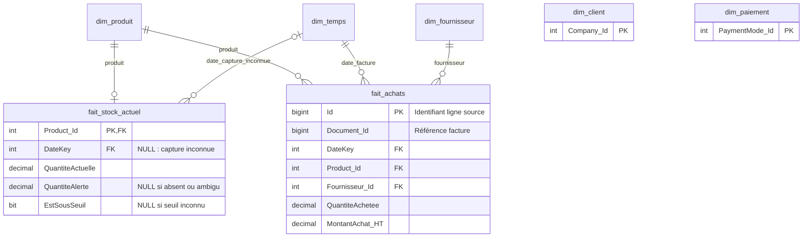

# Modèle livré : cinq dimensions et deux faits

Stock : une ligne par produit dans l'état actuel. Quantité agrégée depuis ProductStocks ; les stocks négatifs sont conservés. Quantité additive entre produits compatibles, pas entre captures temporelles. Seuil non additif, indicateur calculé par comparaison stricte quantité < seuil.

Achats : une ligne DocumentItem appartenant à une facture fournisseur de type 20 et State=1. Quantity devient QuantiteAchetee. PrixTotalHt est le montant de ligne après ses remises propres. On répartit ensuite la remise globale de facture au prorata de ces montants, puis la Colonne dérivée SSIS calcule MontantAchat_HT = TotalHt - RemiseDocument_HT. Le résidu d’arrondi est affecté à la ligne commerciale de plus grand identifiant : la somme des montants nets égale exactement le TotalNetHt de la facture. Document_Id permet de remonter à la facture. Les avoirs type 23 sont exclus : les chiffres représentent des achats facturés hors avoirs.

Les clés produit, fournisseur et date sont vérifiées par les Lookup SSIS et par les clés étrangères SQL. Le membre fournisseur -1 représente une source dont le fournisseur n'est pas renseigné. Les lignes de commentaire sans produit et sans montant ainsi que les brouillons sont conservés dans Rejets_Faits en staging.

Les attributs produit/client existants utilisent le SCD type 1 : une ancienne analyse d'achat utilise donc la famille actuelle du produit. Aucun fait de vente ou de paiement n'est créé ; client et paiement restent des dimensions disponibles pour la suite.
